 

---

## THE MINDSET

I'm **𝓜𝓸𝓰𝔀𝓪𝓼𝓲   𝓘𝓼𝓱𝓶𝓪𝓮𝓵**,  a Computer Scientist and software developer focused on building reliable systems, useful products, and meaningful digital experiences.

I enjoy working across the stack: shaping interfaces, engineering backend services, designing APIs, and connecting the pieces into software that solves real problems.

I believe good engineering is more than making something work. It is making it **clear, dependable, maintainable, and worth using.**

> **Think deeply. Build deliberately. Deliver exceptionally.**

---

## WHAT I BUILD

<table>
<tr>
<td width="50%" valign="top">

### 01 / BACKEND ENGINEERING

- Django and Flask applications
- REST API design and development
- Authentication and authorization
- Database modelling and integration
- Payment workflow integration

</td>
<td width="50%" valign="top">

### 02 / FRONTEND & PRODUCT

- React-based interfaces
- HTML, CSS and JavaScript
- Responsive web experiences
- Bootstrap and interface refinement
- User-focused product development

</td>
</tr>
<tr>
<td width="50%" valign="top">

### 03 / SYSTEMS & DATA

- Python and Java
- SQL and relational databases
- Microsoft SQL Server
- Application architecture
- Data handling and problem solving

</td>
<td width="50%" valign="top">

### 04 / ENGINEERING PRACTICE

- Git and GitHub workflows
- API testing with Postman
- Debugging and iteration
- Modular application design
- Documentation and maintainability

</td>
</tr>
</table>

---

## SELECTED WORK

A selection of systems and engineering projects I'm developing and refining.

| PROJECT | FOCUS | OVERVIEW |
|:--|:--|:--|
| **Hospital Management System** | Django · Python · Database Engineering | A hospital workflow application covering patient records, appointments, dashboards, and M-Pesa payment integration. |
| **Authentication Module** | Django · DRF · JWT | A modular authentication service with registration, token-based login, profile management, password workflows, and email verification. |
| **Authorization Module** | Django · DRF · Permissions | A role- and permission-based authorization module for controlling access to protected application resources. |
| **Checkout Module** | Django · DRF · E-commerce | A modular checkout foundation covering carts, checkout records, checkout items, and payment workflows. |
| **Car Parts E-commerce** | Python · Django/Flask · React | An e-commerce project for browsing and managing car parts, with backend development and frontend integration in progress. |
| **NovaTech** | Web Development · UI Design | A developer-focused digital presence exploring visual identity, responsive layouts, and polished interactions. |

---

## TECHNOLOGY STACK

### LANGUAGES

### FRAMEWORKS & DEVELOPMENT

### DATABASES & TOOLS

---

## CURRENT ENGINEERING FOCUS

- Building modular Django components that can be integrated into larger applications.
- Strengthening full-stack development through practical product work.
- Improving API design, application security, and database architecture.
- Turning working prototypes into reliable, well-structured software.

---

## LET'S CONNECT

I'm open to meaningful conversations, collaborative projects, and opportunities to build useful technology with people who care about quality.

  

